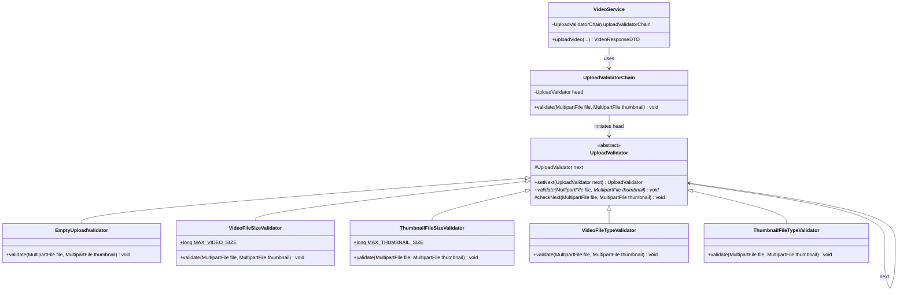

# GoF Chain of Responsibility Pattern Implementation in Video Upload (F1)

## 1. Why Chain of Responsibility Fits Here
Video upload requires a sequence of validation steps (empty check, video size check, thumbnail size check, video MIME type check, and thumbnail MIME type check) before a file is written to storage. Instead of executing multiple inline `if` conditions with hardcoded branching inside `VideoService`, the Chain of Responsibility pattern decouples the request sender from its handlers by passing the multipart upload payload through a structured pipeline of independent, sequential validation links. Each handler either throws on failure or forwards to the next one, so the chain is a fail-fast variant of the pattern.

---

## 2. Pattern Participants

| Participant Role | Class / Abstract Class | Responsibility |
| :--- | :--- | :--- |
| **Handler (Abstract)** | [`UploadValidator`](file:///d:/Study/SLIIT/Y2S1/SE_and_DDD%20project/Project/streamhub/backend/src/main/java/com/streamhub/video/validation/UploadValidator.java) | Declares the common validation contract (`validate(MultipartFile, MultipartFile)`) and maintains the successor link (`setNext`, `checkNext`). |
| **Concrete Handler 1** | [`EmptyUploadValidator`](file:///d:/Study/SLIIT/Y2S1/SE_and_DDD%20project/Project/streamhub/backend/src/main/java/com/streamhub/video/validation/EmptyUploadValidator.java) | Ensures neither the video file nor thumbnail is empty; throws `IllegalArgumentException("Cannot upload empty file or thumbnail")`. |
| **Concrete Handler 2** | [`VideoFileSizeValidator`](file:///d:/Study/SLIIT/Y2S1/SE_and_DDD%20project/Project/streamhub/backend/src/main/java/com/streamhub/video/validation/VideoFileSizeValidator.java) | Ensures the video size does not exceed 100MB; throws `IllegalArgumentException("Video file size exceeds 100MB limit")`. |
| **Concrete Handler 3** | [`ThumbnailFileSizeValidator`](file:///d:/Study/SLIIT/Y2S1/SE_and_DDD%20project/Project/streamhub/backend/src/main/java/com/streamhub/video/validation/ThumbnailFileSizeValidator.java) | Ensures the thumbnail size does not exceed 2MB; throws `IllegalArgumentException("Thumbnail file size exceeds 2MB limit")`. |
| **Concrete Handler 4** | [`VideoFileTypeValidator`](file:///d:/Study/SLIIT/Y2S1/SE_and_DDD%20project/Project/streamhub/backend/src/main/java/com/streamhub/video/validation/VideoFileTypeValidator.java) | Ensures the video MIME type starts with `video/`; throws `IllegalArgumentException("Invalid file type. Only video files are allowed")`. |
| **Concrete Handler 5** | [`ThumbnailFileTypeValidator`](file:///d:/Study/SLIIT/Y2S1/SE_and_DDD%20project/Project/streamhub/backend/src/main/java/com/streamhub/video/validation/ThumbnailFileTypeValidator.java) | Ensures the thumbnail MIME type is `image/jpeg`, `image/png`, or `image/webp`; throws `IllegalArgumentException("Invalid thumbnail type. Only jpg, png, and webp are allowed")`. |
| **Chain Assembler** | [`UploadValidatorChain`](file:///d:/Study/SLIIT/Y2S1/SE_and_DDD%20project/Project/streamhub/backend/src/main/java/com/streamhub/video/validation/UploadValidatorChain.java) | Assembles and initializes the validator pipeline in canonical sequence. |
| **Client** | [`VideoService`](file:///d:/Study/SLIIT/Y2S1/SE_and_DDD%20project/Project/streamhub/backend/src/main/java/com/streamhub/video/service/VideoService.java) | Invokes `uploadValidatorChain.validate(file, thumbnail)` at the start of `uploadVideo`. |

---

## 3. Code Excerpt

### Handler Base Class ([`UploadValidator.java`](file:///d:/Study/SLIIT/Y2S1/SE_and_DDD%20project/Project/streamhub/backend/src/main/java/com/streamhub/video/validation/UploadValidator.java))
```java
public abstract class UploadValidator {

    protected UploadValidator next;

    public UploadValidator setNext(UploadValidator next) {
        this.next = next;
        return next;
    }

    public abstract void validate(MultipartFile file, MultipartFile thumbnail);

    protected void checkNext(MultipartFile file, MultipartFile thumbnail) {
        if (next != null) {
            next.validate(file, thumbnail);
        }
    }
}
```

### Concrete Handler ([`VideoFileSizeValidator.java`](file:///d:/Study/SLIIT/Y2S1/SE_and_DDD%20project/Project/streamhub/backend/src/main/java/com/streamhub/video/validation/VideoFileSizeValidator.java))
```java
public class VideoFileSizeValidator extends UploadValidator {

    public static final long MAX_VIDEO_SIZE = 100 * 1024 * 1024; // 100MB

    @Override
    public void validate(MultipartFile file, MultipartFile thumbnail) {
        if (file.getSize() > MAX_VIDEO_SIZE) {
            throw new IllegalArgumentException("Video file size exceeds 100MB limit");
        }
        checkNext(file, thumbnail);
    }
}
```

---

## 4. Mermaid Class Diagram



---

## 5. Architectural Benefits
1. **Single Responsibility Principle (SRP):** Each validator handler focuses entirely on verifying a single aspect of the upload payload (such as empty payload status, size boundary, or MIME type).
2. **Open/Closed Principle (OCP):** Additional upload checks (e.g. video dimension checks, antivirus scanning, duration limits) can be introduced or existing checks reordered without modifying the core business logic of `VideoService`.
3. **Decoupled Workflow:** `VideoService` remains clean and free of nested validation conditional branching, delegating file integrity assurance entirely to the validation pipeline.
