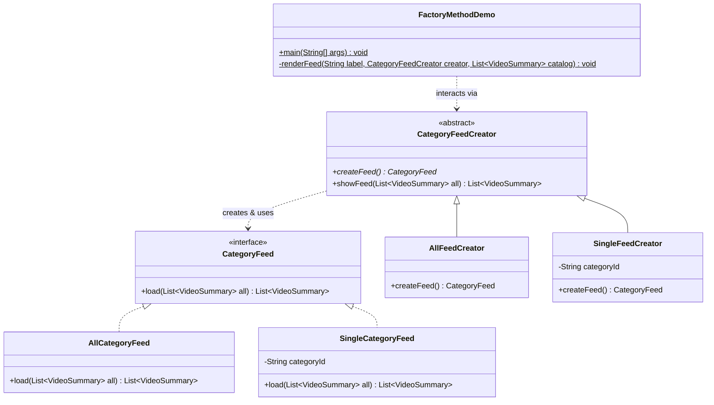

# GoF Factory Method Pattern Implementation in Category Module (F2)

## 1. Architectural Context & Design Evaluation

### 1.1 Intent of the Pattern
The GoF Factory Method pattern defines an interface for creating an object, but lets subclasses decide which class to instantiate. Factory Method lets a class defer instantiation to subclasses, adhering to the Open/Closed Principle (OCP) and Single Responsibility Principle (SRP).

### 1.2 Step 0 Discovery & Production Gate Decision (Part B Gate: NO)
During the architectural discovery of the production Category module:
- `CategoryService.getAllCategories(String search, boolean hasVideos)` contains a 2×2 conditional branching structure based on `hasVideos` and `search != null`.
- However, this branching merely selects which Spring Data repository query to invoke (`findAll()`, `findBySearch()`, `findCategoriesWithVideos()`, or `searchCategoriesWithVideos()`).
- All branches return the exact same entity type (`List<Category>`) with identical downstream DTO mapping and serialization.
- In `VideoService.getVideosByCategory(UUID categoryId, ...)`, the service queries videos by foreign key without creating different feed representations or varying object types.

> [!IMPORTANT]
> **Production Gate Outcome (Part B = NO):**
> Introducing the Factory Method pattern directly into `CategoryService` or `VideoService` would constitute an anti-pattern (forced pattern application), adding abstraction layers where no polymorphism or varying object instantiation exists. In strict adherence to clean software engineering and project constraints, production code was not modified.

### 1.3 Standalone Reference Implementation (Part A)
To demonstrate the proper application of the GoF Factory Method pattern in the StreamHub domain, a standalone reference implementation was constructed in [`examples/f2-factory-method/`](file:///d:/Study/SLIIT/Y2S1/SE_and_DDD%20project/Project/streamhub/docs/design-patterns/examples/f2-factory-method/example/factory/).

In this design, different category browsing experiences require distinct feed behavior:
- **`AllCategoryFeed`**: Aggregates all videos across all categories, sorted strictly chronologically (newest first).
- **`SingleCategoryFeed`**: Isolates videos belonging to a designated category, applying category-specific filtering and chronological ordering.

Subclasses of `CategoryFeedCreator` override the factory method `createFeed()` to supply the appropriate `CategoryFeed` product, allowing client code to request and render feeds without binding to concrete product classes.

---

## 2. Pattern Participants

| Participant Role | Class / Interface | Responsibility |
| :--- | :--- | :--- |
| **Product Interface** | [`CategoryFeed`](file:///d:/Study/SLIIT/Y2S1/SE_and_DDD%20project/Project/streamhub/docs/design-patterns/examples/f2-factory-method/example/factory/CategoryFeed.java) | Defines the common interface for loading, filtering, and sorting category feeds (`load(List<VideoSummary>)`). |
| **Concrete Product 1** | [`AllCategoryFeed`](file:///d:/Study/SLIIT/Y2S1/SE_and_DDD%20project/Project/streamhub/docs/design-patterns/examples/f2-factory-method/example/factory/AllCategoryFeed.java) | Implements feed generation across the entire platform catalog without category boundaries. |
| **Concrete Product 2** | [`SingleCategoryFeed`](file:///d:/Study/SLIIT/Y2S1/SE_and_DDD%20project/Project/streamhub/docs/design-patterns/examples/f2-factory-method/example/factory/SingleCategoryFeed.java) | Implements feed generation scoped to a specific category identifier. |
| **Creator (Abstract)** | [`CategoryFeedCreator`](file:///d:/Study/SLIIT/Y2S1/SE_and_DDD%20project/Project/streamhub/docs/design-patterns/examples/f2-factory-method/example/factory/CategoryFeedCreator.java) | Declares the factory method `createFeed()` and provides the template method `showFeed(List<VideoSummary>)` operating purely against the product interface. |
| **Concrete Creator 1** | [`AllFeedCreator`](file:///d:/Study/SLIIT/Y2S1/SE_and_DDD%20project/Project/streamhub/docs/design-patterns/examples/f2-factory-method/example/factory/AllFeedCreator.java) | Overrides `createFeed()` to instantiate and return an `AllCategoryFeed`. |
| **Concrete Creator 2** | [`SingleFeedCreator`](file:///d:/Study/SLIIT/Y2S1/SE_and_DDD%20project/Project/streamhub/docs/design-patterns/examples/f2-factory-method/example/factory/SingleFeedCreator.java) | Overrides `createFeed()` to instantiate and return a `SingleCategoryFeed` parameterized with a category ID. |
| **Value Object** | [`VideoSummary`](file:///d:/Study/SLIIT/Y2S1/SE_and_DDD%20project/Project/streamhub/docs/design-patterns/examples/f2-factory-method/example/factory/VideoSummary.java) | Immutable record representing video metadata in feeds. |
| **Client / Demo** | [`FactoryMethodDemo`](file:///d:/Study/SLIIT/Y2S1/SE_and_DDD%20project/Project/streamhub/docs/design-patterns/examples/f2-factory-method/example/factory/FactoryMethodDemo.java) | Entry point demonstrating decoupled creation and feed rendering. |

---

## 3. Code Excerpts

### Product Interface ([`CategoryFeed.java`](file:///d:/Study/SLIIT/Y2S1/SE_and_DDD%20project/Project/streamhub/docs/design-patterns/examples/f2-factory-method/example/factory/CategoryFeed.java))
```java
package example.factory;

import java.util.List;

public interface CategoryFeed {
    List<VideoSummary> load(List<VideoSummary> all);
}
```

### Concrete Products ([`AllCategoryFeed.java`](file:///d:/Study/SLIIT/Y2S1/SE_and_DDD%20project/Project/streamhub/docs/design-patterns/examples/f2-factory-method/example/factory/AllCategoryFeed.java) & [`SingleCategoryFeed.java`](file:///d:/Study/SLIIT/Y2S1/SE_and_DDD%20project/Project/streamhub/docs/design-patterns/examples/f2-factory-method/example/factory/SingleCategoryFeed.java))
```java
public class AllCategoryFeed implements CategoryFeed {
    @Override
    public List<VideoSummary> load(List<VideoSummary> all) {
        return all.stream()
                .sorted(Comparator.comparing(VideoSummary::createdAt).reversed())
                .collect(Collectors.toList());
    }
}

public class SingleCategoryFeed implements CategoryFeed {
    private final String categoryId;

    public SingleCategoryFeed(String categoryId) {
        this.categoryId = categoryId;
    }

    @Override
    public List<VideoSummary> load(List<VideoSummary> all) {
        return all.stream()
                .filter(v -> categoryId.equals(v.categoryId()))
                .sorted(Comparator.comparing(VideoSummary::createdAt).reversed())
                .collect(Collectors.toList());
    }
}
```

### Abstract Creator ([`CategoryFeedCreator.java`](file:///d:/Study/SLIIT/Y2S1/SE_and_DDD%20project/Project/streamhub/docs/design-patterns/examples/f2-factory-method/example/factory/CategoryFeedCreator.java))
```java
public abstract class CategoryFeedCreator {

    /**
     * Factory Method: subclasses decide which CategoryFeed to instantiate.
     */
    public abstract CategoryFeed createFeed();

    /**
     * Template method that delegates filtering/sorting to the product
     * returned by the factory method.
     */
    public List<VideoSummary> showFeed(List<VideoSummary> all) {
        CategoryFeed feed = createFeed();
        return feed.load(all);
    }
}
```

### Concrete Creators ([`AllFeedCreator.java`](file:///d:/Study/SLIIT/Y2S1/SE_and_DDD%20project/Project/streamhub/docs/design-patterns/examples/f2-factory-method/example/factory/AllFeedCreator.java) & [`SingleFeedCreator.java`](file:///d:/Study/SLIIT/Y2S1/SE_and_DDD%20project/Project/streamhub/docs/design-patterns/examples/f2-factory-method/example/factory/SingleFeedCreator.java))
```java
public class AllFeedCreator extends CategoryFeedCreator {
    @Override
    public CategoryFeed createFeed() {
        return new AllCategoryFeed();
    }
}

public class SingleFeedCreator extends CategoryFeedCreator {
    private final String categoryId;

    public SingleFeedCreator(String categoryId) {
        this.categoryId = categoryId;
    }

    @Override
    public CategoryFeed createFeed() {
        return new SingleCategoryFeed(categoryId);
    }
}
```

---

## 4. Mermaid Diagrams

### Class Diagram


### Sequence Diagram
```mermaid
sequenceDiagram
    autonumber
    actor Client as FactoryMethodDemo
    participant Creator as SingleFeedCreator
    participant Product as SingleCategoryFeed
    participant Catalog as VideoCatalog

    Client->>Creator: showFeed(catalog)
    activate Creator
    Creator->>Creator: createFeed()
    activate Creator
    create participant Product
    Creator-->>Product: new SingleCategoryFeed("tech")
    Creator-->>Creator: feed
    deactivate Creator
    Creator->>Product: load(catalog)
    activate Product
    Product->>Catalog: filter(categoryId == "tech")
    Product->>Catalog: sort(createdAt DESC)
    Product-->>Creator: filteredVideos
    deactivate Product
    Creator-->>Client: filteredVideos
    deactivate Creator
```

---

## 5. Execution Verification

The standalone example compiles and executes cleanly with Java:

```bash
cd "docs/design-patterns/examples/f2-factory-method"
javac example/factory/*.java
java example.factory.FactoryMethodDemo
```

### Output:
```text
============================================================
 StreamHub Category Module - GoF Factory Method Pattern Demo
============================================================

Total videos in catalog: 6
------------------------------------------------------------

>>> Feed: 'ALL' (AllFeedCreator -> AllCategoryFeed)
  1. [v4] Design Patterns in Java      (Cat: tech    | 3100 views | 2026-10-05T08:43:58.891554800)
  2. [v3] Lo-Fi Beats for Coding       (Cat: music   | 8900 views | 2026-10-05T02:43:58.891554800)
  3. [v2] Top 10 Indie Games 2026      (Cat: gaming  | 5400 views | 2026-10-04T10:43:58.891554800)
  4. [v6] Ambient Chill Guitar         (Cat: music   | 2200 views | 2026-10-03T10:43:58.901548500)
  5. [v1] Spring Boot 3 Deep Dive      (Cat: tech    | 1250 views | 2026-10-02T10:43:58.890556900)
  6. [v5] Elden Ring Speedrun          (Cat: gaming  | 15000 views | 2026-09-30T10:43:58.891554800)

>>> Feed: 'tech' (SingleFeedCreator -> SingleCategoryFeed)
  1. [v4] Design Patterns in Java      (Cat: tech    | 3100 views | 2026-10-05T08:43:58.891554800)
  2. [v1] Spring Boot 3 Deep Dive      (Cat: tech    | 1250 views | 2026-10-02T10:43:58.890556900)

>>> Feed: 'gaming' (SingleFeedCreator -> SingleCategoryFeed)
  1. [v2] Top 10 Indie Games 2026      (Cat: gaming  | 5400 views | 2026-10-04T10:43:58.891554800)
  2. [v5] Elden Ring Speedrun          (Cat: gaming  | 15000 views | 2026-09-30T10:43:58.891554800)

============================================================
 Demo completed successfully.
============================================================
```

---

## 6. Architectural Benefits & Trade-offs

1. **Strict Decoupling of Product Creation (OCP):**
   New feed types (such as `TrendingCategoryFeed`, `RecommendedCategoryFeed`, or `WatchHistoryCategoryFeed`) can be introduced by creating a new `CategoryFeed` implementation and a corresponding `CategoryFeedCreator` subclass without altering existing creator or feed classes.
2. **Template Method Synergy:**
   The abstract creator provides common orchestration (`showFeed`) while delegating the variation point (`createFeed`) to subclasses.
3. **Appropriate Boundary:**
   Distinguishing between query-level parameters (best handled via JPA/SQL queries) and behavioral variation (handled via Factory Method) preserves code clarity and prevents over-engineering.
