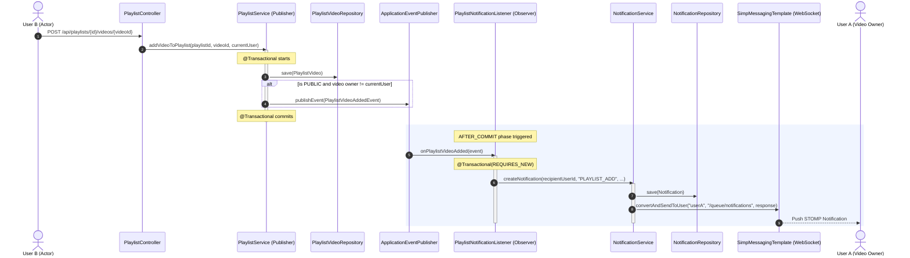

# GoF Observer Pattern Implementation in Playlist Module (F3)

## 1. Why Observer Fits Here
Adding a video to a public playlist triggers secondary side effects such as sending notifications and pushing live updates to the video creator. Coupling `PlaylistService` directly to `NotificationService` violates the Single Responsibility and Open-Closed principles by making playlist management aware of user alerting mechanisms. The GoF Observer pattern decouples the subject (`PlaylistService`) from the observer (`PlaylistNotificationListener`) by publishing an immutable domain event (`PlaylistVideoAddedEvent`) that listeners can react to independently.

---

## 2. Pattern Participants

| Participant Role | Class / Record | Responsibility |
| :--- | :--- | :--- |
| **Subject / Publisher** | [`PlaylistService`](file:///d:/Study/SLIIT/Y2S1/SE_and_DDD%20project/Project/streamhub/backend/src/main/java/com/streamhub/playlist/service/PlaylistService.java) | Executes playlist domain logic (validating ownership, video presence, and saving `PlaylistVideo`), then publishes `PlaylistVideoAddedEvent` via Spring's `ApplicationEventPublisher`. It has zero knowledge of `NotificationService`. |
| **Event (Domain Fact)** | [`PlaylistVideoAddedEvent`](file:///d:/Study/SLIIT/Y2S1/SE_and_DDD%20project/Project/streamhub/backend/src/main/java/com/streamhub/playlist/event/PlaylistVideoAddedEvent.java) | An immutable Java record carrying only domain identifiers and primitive/String values (`playlistId`, `playlistName`, `videoId`, `videoTitle`, `actorUserId`, `actorUsername`, `recipientUserId`). It avoids holding JPA entity references to prevent lazy loading issues across transaction boundaries. |
| **Observer / Listener** | [`PlaylistNotificationListener`](file:///d:/Study/SLIIT/Y2S1/SE_and_DDD%20project/Project/streamhub/backend/src/main/java/com/streamhub/playlist/event/PlaylistNotificationListener.java) | Listens for `PlaylistVideoAddedEvent` after transaction commit and delegates to `NotificationService.createNotification(...)` to persist the notification record and trigger the STOMP WebSocket broadcast. |

---

## 3. Code Excerpts

### Event (`PlaylistVideoAddedEvent.java`)
```java
package com.streamhub.playlist.event;

import java.util.UUID;

public record PlaylistVideoAddedEvent(
        UUID playlistId,
        String playlistName,
        UUID videoId,
        String videoTitle,
        UUID actorUserId,
        String actorUsername,
        UUID recipientUserId
) {}
```

### Publisher (`PlaylistService.java`)
```java
// Inside addVideoToPlaylist(...)
int position = playlistVideoRepository.countByPlaylist(playlist);
PlaylistVideo playlistVideo = new PlaylistVideo(playlist, video, position);
playlistVideoRepository.save(playlistVideo);

// Publish event to notify video owner if another user adds their video to a public playlist
if (eventPublisher != null && "PUBLIC".equalsIgnoreCase(playlist.getPrivacy()) 
        && video.getOwner() != null && currentUser != null 
        && !video.getOwner().getUserId().equals(currentUser.getUserId())) {
    eventPublisher.publishEvent(new PlaylistVideoAddedEvent(
            playlist.getPlaylistId(),
            playlist.getName(),
            video.getVideoId(),
            video.getTitle(),
            currentUser.getUserId(),
            currentUser.getUsername(),
            video.getOwner().getUserId()
    ));
}
```

### Observer / Listener (`PlaylistNotificationListener.java`)
```java
@Component
public class PlaylistNotificationListener {

    private final NotificationService notificationService;

    public PlaylistNotificationListener(NotificationService notificationService) {
        this.notificationService = notificationService;
    }

    @TransactionalEventListener(phase = TransactionPhase.AFTER_COMMIT, fallbackExecution = true)
    @Transactional(propagation = Propagation.REQUIRES_NEW)
    public void onPlaylistVideoAdded(PlaylistVideoAddedEvent event) {
        if (notificationService == null || event == null) {
            return;
        }

        try {
            String title = "Video Added to Public Playlist";
            String message = event.actorUsername() + " added your video \"" + event.videoTitle() + "\" to the public playlist \"" + event.playlistName() + "\".";
            
            notificationService.createNotification(
                    event.recipientUserId(),
                    "PLAYLIST_ADD",
                    title,
                    message,
                    "PLAYLIST",
                    event.playlistId()
            );
        } catch (Exception e) {
            System.err.println("Failed to send playlist notification: " + e.getMessage());
        }
    }
}
```

---

## 4. Sequence Diagram



---

## 5. Benefits and Transaction Semantics

### Architectural Benefits
1. **Separation of Concerns & Decoupling**: `PlaylistService` contains purely playlist track sequencing and domain logic; it no longer directly depends on `NotificationService` or needs to know how notifications are formatted or delivered.
2. **Extensibility (Open-Closed Principle)**: Additional observers (such as audit logs, analytics counters, or badge trackers) can subscribe to `PlaylistVideoAddedEvent` without altering `PlaylistService`.
3. **Immutability & Safety**: The `PlaylistVideoAddedEvent` record transfers immutable domain primitives, ensuring no entity detachment or lazy-loading issues occur.

### Transaction Semantics: `AFTER_COMMIT` and `REQUIRES_NEW`
- **`TransactionPhase.AFTER_COMMIT`**: Ensures that notifications are dispatched only after the playlist addition transaction has successfully committed to the database. If the playlist track insertion rolls back due to a constraint violation or exception, no phantom notification is sent.
- **`fallbackExecution = true`**: Guarantees that if `publishEvent` is ever called outside of an active Spring transaction (for example in a test harness or non-transactional context), the event is processed instead of being dropped silently.
- **`Propagation.REQUIRES_NEW`**: Because the listener executes in the `AFTER_COMMIT` phase, the original database transaction has already ended. Any persistent database writes executed during notification creation (such as saving the `Notification` record in `NotificationRepository`) must run in a newly opened, independent transaction to ensure they are committed.
