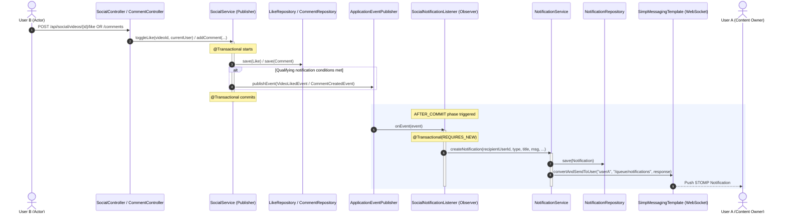

# GoF Observer Pattern Implementation in Social Module (F4)

## 1. Why Observer Fits Here
Social interactions (liking a video, liking a comment, adding a comment, or replying to a comment) trigger secondary notification side effects and real-time STOMP WebSocket pushes to content owners. Direct coupling between `SocialService` and `NotificationService` introduces tight architectural coupling, making social business logic directly dependent on notification formatting, persistence, and messaging infrastructure. The GoF Observer pattern decouples the subject (`SocialService`) from the observer (`SocialNotificationListener`) by publishing lightweight, immutable domain events (`VideoLikedEvent`, `CommentLikedEvent`, `CommentCreatedEvent`, `CommentRepliedEvent`) via Spring's `ApplicationEventPublisher`.

---

## 2. Pattern Participants

| Participant Role | Class / Record | Responsibility |
| :--- | :--- | :--- |
| **Subject / Publisher** | [`SocialService`](file:///d:/Study/SLIIT/Y2S1/SE_and_DDD%20project/Project/streamhub/backend/src/main/java/com/streamhub/social/service/SocialService.java) | Handles core social domain operations (like toggles, comment nesting, and author validation). When a qualifying social action occurs, it publishes the corresponding domain event. It maintains zero dependencies on `NotificationService`. |
| **Event: Video Liked** | [`VideoLikedEvent`](file:///d:/Study/SLIIT/Y2S1/SE_and_DDD%20project/Project/streamhub/backend/src/main/java/com/streamhub/social/event/VideoLikedEvent.java) | Immutable record carrying `videoId`, `videoTitle`, `actorUserId`, `actorUsername`, and `recipientUserId`. |
| **Event: Comment Liked** | [`CommentLikedEvent`](file:///d:/Study/SLIIT/Y2S1/SE_and_DDD%20project/Project/streamhub/backend/src/main/java/com/streamhub/social/event/CommentLikedEvent.java) | Immutable record carrying `commentId`, `videoTitle`, `actorUserId`, `actorUsername`, and `recipientUserId`. |
| **Event: Comment Created** | [`CommentCreatedEvent`](file:///d:/Study/SLIIT/Y2S1/SE_and_DDD%20project/Project/streamhub/backend/src/main/java/com/streamhub/social/event/CommentCreatedEvent.java) | Immutable record carrying `videoId`, `videoTitle`, `actorUserId`, `actorUsername`, `recipientUserId`, and `commentPreview`. |
| **Event: Comment Replied** | [`CommentRepliedEvent`](file:///d:/Study/SLIIT/Y2S1/SE_and_DDD%20project/Project/streamhub/backend/src/main/java/com/streamhub/social/event/CommentRepliedEvent.java) | Immutable record carrying `videoId`, `videoTitle`, `actorUserId`, `actorUsername`, `recipientUserId`, and `commentPreview`. |
| **Observer / Listener** | [`SocialNotificationListener`](file:///d:/Study/SLIIT/Y2S1/SE_and_DDD%20project/Project/streamhub/backend/src/main/java/com/streamhub/social/event/SocialNotificationListener.java) | Listens for each social event in the `AFTER_COMMIT` phase, builds formatted notification titles and messages, and delegates persistence and WebSocket broadcasting to `NotificationService`. |

---

## 3. Code Excerpts

### Domain Events
```java
public record VideoLikedEvent(UUID videoId, String videoTitle, UUID actorUserId, String actorUsername, UUID recipientUserId) {}
public record CommentLikedEvent(UUID commentId, String videoTitle, UUID actorUserId, String actorUsername, UUID recipientUserId) {}
public record CommentCreatedEvent(UUID videoId, String videoTitle, UUID actorUserId, String actorUsername, UUID recipientUserId, String commentPreview) {}
public record CommentRepliedEvent(UUID videoId, String videoTitle, UUID actorUserId, String actorUsername, UUID recipientUserId, String commentPreview) {}
```

### Publisher Excerpt (`SocialService.java`)
```java
// Publishing in toggleLike / addLike
if (eventPublisher != null && video.getOwner() != null && user != null 
        && !video.getOwner().getUserId().equals(user.getUserId())) {
    eventPublisher.publishEvent(new VideoLikedEvent(
            video.getVideoId(),
            video.getTitle(),
            user.getUserId(),
            user.getUsername(),
            video.getOwner().getUserId()
    ));
}

// Publishing in addComment (Video Owner Notification + Parent Comment Author Notification)
if (eventPublisher != null && user != null) {
    String commentPreview = trimmedText.length() > 60 ? trimmedText.substring(0, 57) + "..." : trimmedText;

    if (video.getOwner() != null && !video.getOwner().getUserId().equals(user.getUserId())) {
        eventPublisher.publishEvent(new CommentCreatedEvent(
                video.getVideoId(),
                video.getTitle(),
                user.getUserId(),
                user.getUsername(),
                video.getOwner().getUserId(),
                commentPreview
        ));
    }

    if (parent != null && parent.getAuthor() != null) {
        UUID parentAuthorId = parent.getAuthor().getUserId();
        UUID videoOwnerId = video.getOwner() != null ? video.getOwner().getUserId() : null;
        if (!parentAuthorId.equals(user.getUserId()) && !parentAuthorId.equals(videoOwnerId)) {
            eventPublisher.publishEvent(new CommentRepliedEvent(
                    video.getVideoId(),
                    video.getTitle(),
                    user.getUserId(),
                    user.getUsername(),
                    parentAuthorId,
                    commentPreview
            ));
        }
    }
}
```

### Observer / Listener Excerpt (`SocialNotificationListener.java`)
```java
@Component
public class SocialNotificationListener {

    private final NotificationService notificationService;

    public SocialNotificationListener(NotificationService notificationService) {
        this.notificationService = notificationService;
    }

    @TransactionalEventListener(phase = TransactionPhase.AFTER_COMMIT, fallbackExecution = true)
    @Transactional(propagation = Propagation.REQUIRES_NEW)
    public void onVideoLiked(VideoLikedEvent event) {
        if (notificationService == null || event == null) return;
        try {
            String title = "New Like on Your Video";
            String message = event.actorUsername() + " liked your video \"" + event.videoTitle() + "\".";
            notificationService.createNotification(event.recipientUserId(), "LIKE", title, message, "VIDEO", event.videoId());
        } catch (Exception e) {
            System.err.println("Failed to send like notification: " + e.getMessage());
        }
    }

    @TransactionalEventListener(phase = TransactionPhase.AFTER_COMMIT, fallbackExecution = true)
    @Transactional(propagation = Propagation.REQUIRES_NEW)
    public void onCommentLiked(CommentLikedEvent event) {
        if (notificationService == null || event == null) return;
        try {
            String title = "New Like on Your Comment";
            String message = event.actorUsername() + " liked your comment on \"" + event.videoTitle() + "\".";
            notificationService.createNotification(event.recipientUserId(), "COMMENT_LIKE", title, message, "COMMENT", event.commentId());
        } catch (Exception e) {
            System.err.println("Failed to send comment like notification: " + e.getMessage());
        }
    }

    @TransactionalEventListener(phase = TransactionPhase.AFTER_COMMIT, fallbackExecution = true)
    @Transactional(propagation = Propagation.REQUIRES_NEW)
    public void onCommentCreated(CommentCreatedEvent event) {
        if (notificationService == null || event == null) return;
        try {
            String title = "New Comment on Your Video";
            String message = event.actorUsername() + " commented on your video \"" + event.videoTitle() + "\": \"" + event.commentPreview() + "\"";
            notificationService.createNotification(event.recipientUserId(), "COMMENT", title, message, "VIDEO", event.videoId());
        } catch (Exception e) {
            System.err.println("Failed to send comment notification: " + e.getMessage());
        }
    }

    @TransactionalEventListener(phase = TransactionPhase.AFTER_COMMIT, fallbackExecution = true)
    @Transactional(propagation = Propagation.REQUIRES_NEW)
    public void onCommentReplied(CommentRepliedEvent event) {
        if (notificationService == null || event == null) return;
        try {
            String title = "New Reply to Your Comment";
            String message = event.actorUsername() + " replied to your comment on \"" + event.videoTitle() + "\": \"" + event.commentPreview() + "\"";
            notificationService.createNotification(event.recipientUserId(), "COMMENT_REPLY", title, message, "VIDEO", event.videoId());
        } catch (Exception e) {
            System.err.println("Failed to send comment reply notification: " + e.getMessage());
        }
    }
}
```

---

## 4. Sequence Diagram



---

## 5. Benefits and Transaction Semantics

### Architectural Benefits
1. **Separation of Concerns**: `SocialService` manages social domain interactions without coupling to alerting, notification schemas, or STOMP channels.
2. **Extensibility**: Additional subscribers (e.g. user activity feeds, gamification badges, metrics collectors) can listen to `VideoLikedEvent`, `CommentLikedEvent`, or `CommentCreatedEvent` without touching social transaction code.
3. **Domain Event Cleanliness**: Events pass primitive identifiers and Strings, eliminating lazy loading errors and avoiding JPA entity detachment across threads or transaction phases.

### Transaction Semantics: `AFTER_COMMIT` and `REQUIRES_NEW`
- **`TransactionPhase.AFTER_COMMIT`**: Ensures notifications are dispatched only after the like or comment transaction has cleanly committed. If an operation rolls back, no false notification is delivered.
- **`fallbackExecution = true`**: Guarantees that if events are published outside an active transaction (e.g., unit/integration tests without active transactions), the event handlers still execute.
- **`Propagation.REQUIRES_NEW`**: Because the original database transaction is already committed when the listener runs, the listener executes within a new, independent transaction so that notification persistence is guaranteed to commit.
