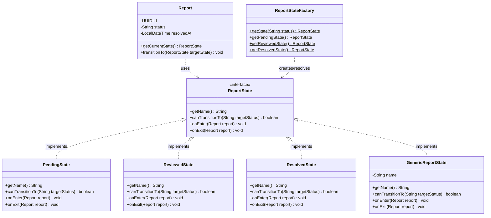

# GoF State Pattern Implementation in Report Management (F5)

## 1. Why State Fits Here
A content moderation `Report` progresses through distinct lifecycle phases (`PENDING`, `REVIEWED`, `RESOLVED`) that govern how timestamps (such as `resolvedAt`), transitions, and notifications are handled. Instead of scattering procedural `if/else` checks across service methods whenever a status changes, the State pattern encapsulates status-specific behavior and lifecycle hooks inside dedicated state objects, allowing the report to alter its behavior dynamically as its internal state changes.

---

## 2. Pattern Participants

| Participant Role | Class / Interface | Responsibility |
| :--- | :--- | :--- |
| **Context** | [`Report`](file:///d:/Study/SLIIT/Y2S1/SE_and_DDD%20project/Project/streamhub/backend/src/main/java/com/streamhub/report/entity/Report.java) | Maintains reference to current status and delegates lifecycle transitions via `transitionTo(ReportState)`. |
| **State Interface** | [`ReportState`](file:///d:/Study/SLIIT/Y2S1/SE_and_DDD%20project/Project/streamhub/backend/src/main/java/com/streamhub/report/state/ReportState.java) | Declares common lifecycle contracts (`getName()`, `canTransitionTo()`, `onEnter()`, `onExit()`). |
| **Concrete State 1** | [`PendingState`](file:///d:/Study/SLIIT/Y2S1/SE_and_DDD%20project/Project/streamhub/backend/src/main/java/com/streamhub/report/state/PendingState.java) | Encapsulates behavior for pending triage. |
| **Concrete State 2** | [`ReviewedState`](file:///d:/Study/SLIIT/Y2S1/SE_and_DDD%20project/Project/streamhub/backend/src/main/java/com/streamhub/report/state/ReviewedState.java) | Encapsulates behavior for reports under active review. |
| **Concrete State 3** | [`ResolvedState`](file:///d:/Study/SLIIT/Y2S1/SE_and_DDD%20project/Project/streamhub/backend/src/main/java/com/streamhub/report/state/ResolvedState.java) | Encapsulates finalized state; populates `resolvedAt` timestamp on entry. |
| **Fallback State** | [`GenericReportState`](file:///d:/Study/SLIIT/Y2S1/SE_and_DDD%20project/Project/streamhub/backend/src/main/java/com/streamhub/report/state/GenericReportState.java) | Preserves full backward compatibility for arbitrary/custom status strings. |
| **Factory / Resolver** | [`ReportStateFactory`](file:///d:/Study/SLIIT/Y2S1/SE_and_DDD%20project/Project/streamhub/backend/src/main/java/com/streamhub/report/state/ReportStateFactory.java) | Maps status strings to corresponding state instances. |

---

## 3. Code Excerpt

### State Interface ([`ReportState.java`](file:///d:/Study/SLIIT/Y2S1/SE_and_DDD%20project/Project/streamhub/backend/src/main/java/com/streamhub/report/state/ReportState.java))
```java
public interface ReportState {
    String getName();
    boolean canTransitionTo(String targetStatus);
    void onEnter(Report report);
    void onExit(Report report);
}
```

### Concrete State ([`ResolvedState.java`](file:///d:/Study/SLIIT/Y2S1/SE_and_DDD%20project/Project/streamhub/backend/src/main/java/com/streamhub/report/state/ResolvedState.java))
```java
public class ResolvedState implements ReportState {
    @Override
    public String getName() {
        return "RESOLVED";
    }

    @Override
    public boolean canTransitionTo(String targetStatus) {
        return targetStatus != null;
    }

    @Override
    public void onEnter(Report report) {
        if (report != null) {
            report.setStatus("RESOLVED");
            report.setResolvedAt(LocalDateTime.now());
        }
    }

    @Override
    public void onExit(Report report) {
        //no-op on leaving resolved state
    }
}
```

---

## 4. Mermaid Class Diagram



---

## 5. Architectural Benefits
1. **Open/Closed Principle (OCP):** New report states (e.g., `ESCALATED`, `APPEALED`) can be introduced without editing conditional branching throughout `ReportService`.
2. **Elimination of Scattered If-Chains:** Side effects associated with lifecycle states (such as setting `resolvedAt` on resolution) are centralized within their respective state classes rather than duplicated across controller or service methods.
3. **Identical External Behavior:** Because `Report.status` remains a string column and transition rules map seamlessly through `ReportStateFactory`, all database schemas, REST APIs, DTOs, and frontend contracts remain 100% compatible.
