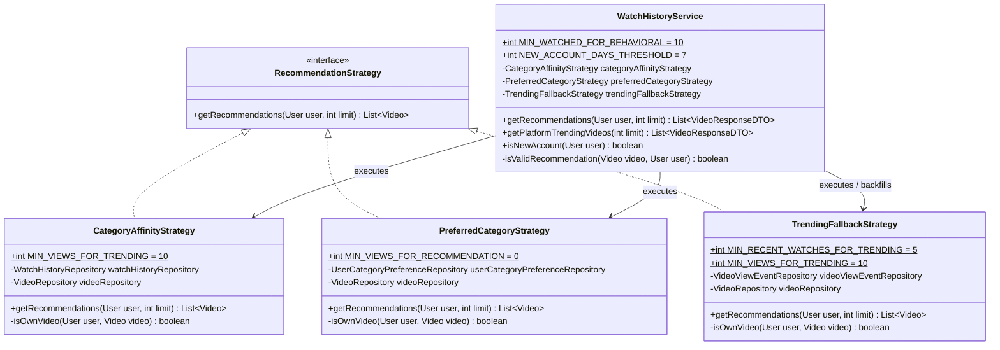
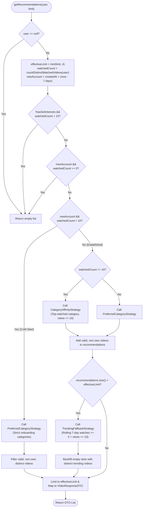

# GoF Strategy Pattern Implementation in Recommendation Engine (F6)

## 1. Why Strategy Fits Here
The recommendation engine needs to calculate video suggestions using fundamentally different algorithms depending on user profile maturity and history volume (onboarding category preferences, watch history behavioral affinity, or platform-wide trending metrics). Encapsulating each ranking and filtering algorithm into its own strategy class isolates distinct data dependencies and algorithmic rules behind a common contract. This allows algorithms to be developed, optimized, tested, and swapped independently without bloating the central service.

---

## 2. Pattern Participants

| Participant Role | Class / Interface | Responsibility |
| :--- | :--- | :--- |
| **Strategy Interface** | [`RecommendationStrategy`](file:///d:/Study/SLIIT/Y2S1/SE_and_DDD%20project/Project/streamhub/backend/src/main/java/com/streamhub/watchhistory/service/RecommendationStrategy.java) | Common contract defining `List<Video> getRecommendations(User user, int limit)`. |
| **Concrete Strategy 1** | [`CategoryAffinityStrategy`](file:///d:/Study/SLIIT/Y2S1/SE_and_DDD%20project/Project/streamhub/backend/src/main/java/com/streamhub/watchhistory/service/CategoryAffinityStrategy.java) | Behavioral strategy for active viewers; identifies the user's single most-watched category and fetches public videos with `viewCount >= 10`. |
| **Concrete Strategy 2** | [`PreferredCategoryStrategy`](file:///d:/Study/SLIIT/Y2S1/SE_and_DDD%20project/Project/streamhub/backend/src/main/java/com/streamhub/watchhistory/service/PreferredCategoryStrategy.java) | Cold-start strategy using categories selected during onboarding; queries public videos across preferred categories ordered by view count (`minViews = 0`). |
| **Concrete Strategy 3** | [`TrendingFallbackStrategy`](file:///d:/Study/SLIIT/Y2S1/SE_and_DDD%20project/Project/streamhub/backend/src/main/java/com/streamhub/watchhistory/service/TrendingFallbackStrategy.java) | Fallback & exploration strategy; retrieves videos from a rolling 7-day window with `>= 5` watch events and lifetime `viewCount >= 10`, backfilling with public videos if needed. |
| **Context** | [`WatchHistoryService`](file:///d:/Study/SLIIT/Y2S1/SE_and_DDD%20project/Project/streamhub/backend/src/main/java/com/streamhub/watchhistory/service/WatchHistoryService.java) | Evaluates user account age and watch volume thresholds, orchestrates primary strategy execution, handles de-duplication, and triggers trending backfill. |

---

## 3. Code Excerpts

### Strategy Interface ([`RecommendationStrategy.java`](file:///d:/Study/SLIIT/Y2S1/SE_and_DDD%20project/Project/streamhub/backend/src/main/java/com/streamhub/watchhistory/service/RecommendationStrategy.java))
```java
package com.streamhub.watchhistory.service;

import com.streamhub.common.entity.User;
import com.streamhub.video.entity.Video;

import java.util.List;

//interface defining algorithm contract for video recommendations
public interface RecommendationStrategy {
    List<Video> getRecommendations(User user, int limit);
}
```

### Context Selection & Backfill Logic ([`WatchHistoryService.java`](file:///d:/Study/SLIIT/Y2S1/SE_and_DDD%20project/Project/streamhub/backend/src/main/java/com/streamhub/watchhistory/service/WatchHistoryService.java#L113-L178))
```java
@Transactional(readOnly = true)
//recommendation calculation with behavioral preferred and trending strategy order
public List<VideoResponseDTO> getRecommendations(User user, int limit) {
    if (user == null) {
        return new java.util.ArrayList<>();
    }

    int effectiveLimit = Math.min(limit, 4);

    long watchedCount = watchHistoryRepository.countDistinctWatchedVideosByUser(user);
    boolean newAccount = isNewAccount(user);

    //gate fresh accounts with neither onboarding preferences nor behavioral history
    if (!user.isHasSetInterests() && watchedCount < MIN_WATCHED_FOR_BEHAVIORAL) {
        return new java.util.ArrayList<>();
    }

    //if watch history was cleared (or 0 watched) on established accounts (> 7 days old), return empty
    if (!newAccount && watchedCount == 0) {
        return new java.util.ArrayList<>();
    }

    List<Video> recommendations = new java.util.ArrayList<>();

    if (newAccount && watchedCount < MIN_WATCHED_FOR_BEHAVIORAL) {
        // New account (<= 7 days old) cold start: recommendations are strictly based on preferred categories (no trending fallback)
        List<Video> primary = preferredCategoryStrategy.getRecommendations(user, effectiveLimit);
        if (primary != null) {
            for (Video v : primary) {
                if (isValidRecommendation(v, user) && !recommendations.contains(v) && recommendations.size() < effectiveLimit) {
                    recommendations.add(v);
                }
            }
        }
    } else {
        // Established account (> 7 days old or has enough behavioral history):
        List<Video> primary = (watchedCount >= MIN_WATCHED_FOR_BEHAVIORAL)
                ? categoryAffinityStrategy.getRecommendations(user, effectiveLimit)
                : preferredCategoryStrategy.getRecommendations(user, effectiveLimit);

        if (primary != null) {
            for (Video v : primary) {
                if (isValidRecommendation(v, user) && !recommendations.contains(v) && recommendations.size() < effectiveLimit) {
                    recommendations.add(v);
                }
            }
        }

        // Backfill with platform trending if slots remaining after preferred categories or behavioral affinity
        if (recommendations.size() < effectiveLimit) {
            List<Video> trending = trendingFallbackStrategy.getRecommendations(user, effectiveLimit);
            if (trending != null) {
                for (Video v : trending) {
                    if (isValidRecommendation(v, user) && !recommendations.contains(v) && recommendations.size() < effectiveLimit) {
                        recommendations.add(v);
                    }
                }
            }
        }
    }

    return recommendations.stream()
            .filter(v -> isValidRecommendation(v, user))
            .limit(effectiveLimit)
            .map(this::mapVideoToDTO)
            .collect(Collectors.toList());
}
```

---

## 4. How a Request Flows (Real Thresholds & Conditions)

When a client requests recommendations (`GET /api/watch-history/recommendations?limit=...`):

1. **Parameter Normalization & Safety Cap:**
   - The requested `limit` is capped at **4**: `effectiveLimit = Math.min(limit, 4)`.
   - If `user == null`, an empty list is immediately returned.
2. **Account Maturity & Activity Inspection:**
   - Computes `watchedCount = watchHistoryRepository.countDistinctWatchedVideosByUser(user)`.
   - Determines `newAccount`: returns `true` if `user.getCreatedAt()` is within `NEW_ACCOUNT_DAYS_THRESHOLD` (**7 days**).
3. **Hard Guard Gates:**
   - **Fresh Account Gate:** If `!user.isHasSetInterests()` AND `watchedCount < 10` (`MIN_WATCHED_FOR_BEHAVIORAL`), returns an empty list (prevents random noise until onboarding interests or enough history exist).
   - **Cleared History Gate:** If established account (`!newAccount`) and `watchedCount == 0` (e.g., user explicitly cleared their watch history), returns an empty list respecting user privacy.
4. **Execution Branch A — New Account Cold Start (`newAccount && watchedCount < 10`):**
   - Calls **`PreferredCategoryStrategy.getRecommendations(user, effectiveLimit)`**.
   - Queries category IDs from `UserCategoryPreferenceRepository`.
   - Fetches public videos matching those categories with `MIN_VIEWS_FOR_RECOMMENDATION = 0`, sorted by view count descending.
   - **Strict Isolation:** No trending fallback is allowed on this branch, preventing algorithmic drift before the user engages.
5. **Execution Branch B — Established or Active Account (`!newAccount || watchedCount >= 10`):**
   - **Primary Strategy Execution:**
     - If `watchedCount >= 10`: Executes **`CategoryAffinityStrategy.getRecommendations(user, effectiveLimit)`**. Finds the top-watched category from `watchHistoryRepository` and queries videos with `MIN_VIEWS_FOR_TRENDING = 10`.
     - Else (`watchedCount < 10`): Executes **`PreferredCategoryStrategy.getRecommendations(user, effectiveLimit)`**.
   - **Backfill Stage:**
     - If `recommendations.size() < effectiveLimit`, invokes **`TrendingFallbackStrategy.getRecommendations(user, effectiveLimit)`**.
     - First pulls videos with `>= 5` watches (`MIN_RECENT_WATCHES_FOR_TRENDING`) in the past 7 days and `>= 10` views (`MIN_VIEWS_FOR_TRENDING`).
     - If still under `effectiveLimit`, queries overall public videos with `>= 10` views.
6. **Validation, De-duplication & Projection:**
   - Each candidate video passes through `isValidRecommendation(video, user)`:
     - `video != null` and `!video.isHidden()`.
     - `video.getPrivacy().equalsIgnoreCase("PUBLIC")`.
     - User cannot be recommended their own video (`userId` and `username` checks against `video.getOwner()`).
   - Duplicate prevention is maintained via `!recommendations.contains(v)`.
   - Results are capped at `effectiveLimit` and transformed into `VideoResponseDTO`.

---

## 5. Mermaid Diagrams

### Class Diagram


### Flowchart of Selection & Backfill Logic


---

## 6. Architectural Note: Context-Driven Selection & Multi-Strategy Backfill

> [!NOTE]
> In canonical textbook GoF Strategy, a client typically configures the Context with a single Strategy object from the outside (`context.setStrategy(strategy)`), and the Context simply delegates to that strategy.
>
> In StreamHub's implementation:
> 1. **Selection within Context:** Strategy selection is handled directly inside `WatchHistoryService.getRecommendations()` using stateful domain conditionals (`watchedCount >= MIN_WATCHED_FOR_BEHAVIORAL`, `newAccount`, `hasSetInterests`). This encapsulates recommendation routing inside the domain service so controllers and API consumers remain agnostic of algorithm selection.
> 2. **Multi-Strategy Hybrid Pipeline (Backfill):** `TrendingFallbackStrategy` is used **both** as a fallback and as a dynamic **backfill**. When the primary strategy (`CategoryAffinityStrategy` or `PreferredCategoryStrategy`) returns fewer items than `effectiveLimit` (e.g., only 2 qualifying videos found), `TrendingFallbackStrategy` is invoked in the same request to fill the remaining 2 slots. The strategies therefore collaborate in a prioritized pipeline rather than functioning exclusively as mutually exclusive alternatives.

---

## 7. Likely Viva Questions & Grounded Answers

### Q1: Why use the Strategy pattern here instead of writing all recommendation logic directly inside `WatchHistoryService` with private helper methods?
> **Answer:** 
> Combining all three recommendation routines into `WatchHistoryService` would violate the **Single Responsibility Principle (SRP)** and make the class unwieldy. Each strategy interacts with different database repositories (`CategoryAffinityStrategy` depends on `WatchHistoryRepository`, `PreferredCategoryStrategy` depends on `UserCategoryPreferenceRepository`, and `TrendingFallbackStrategy` depends on `VideoViewEventRepository`). 
> 
> Isolating each into an implementation of `RecommendationStrategy`:
> - Keeps `WatchHistoryService` focused purely on policy decisions (threshold checks, user gating, de-duplication, backfill).
> - Allows each algorithm to change its SQL queries, ranking weights, or caching without touching other strategies or the central service.

---

### Q2: How would you introduce a 4th recommendation strategy (e.g., `CollaborativeFilteringStrategy` or `CreatorAffinityStrategy`) without editing existing strategies?
> **Answer:**
> Thanks to the **Open/Closed Principle (OCP)**:
> 1. Create a new class `CollaborativeFilteringStrategy implements RecommendationStrategy` and implement `getRecommendations(User user, int limit)`.
> 2. Annotate it with `@Service` and inject whatever specific repositories or ML client it requires.
> 3. Inject this new bean into `WatchHistoryService`.
> 4. Add the routing condition inside `WatchHistoryService` where this strategy should take priority.
> 
> None of the existing concrete strategies (`CategoryAffinityStrategy`, `PreferredCategoryStrategy`, `TrendingFallbackStrategy`) require modification or recompilation.

---

### Q3: How are the individual strategies tested in the codebase?
> **Answer:**
> As demonstrated in [`WatchHistoryRecommendationTest.java`](file:///d:/Study/SLIIT/Y2S1/SE_and_DDD%20project/Project/streamhub/backend/src/test/java/com/streamhub/watchhistory/WatchHistoryRecommendationTest.java), strategies are tested as unit tests using **JUnit 5 and Mockito**:
> - **Isolated Strategy Unit Tests:** In `testTrendingFallbackFiltersBelowThresholdAndBackfills()`, `TrendingFallbackStrategy` is tested directly by mocking `VideoViewEventRepository` and `VideoRepository`. The test verifies that videos with `< 5` recent watches are omitted and the 2nd slot is backfilled from public trending videos.
> - **Behavioral Threshold Testing:** In `testCategoryAffinityFiltersBelowThresholdAndBackfills()`, `CategoryAffinityStrategy` is tested with a mocked `watchHistoryRepository.findMostWatchedCategoryDataByUser` to verify that `MIN_VIEWS_FOR_TRENDING = 10` is enforced.
> - **Context Orchestration Tests:** In `testColdStartRecommendationsUsePreferredCategories()`, the interaction across `WatchHistoryService` and `PreferredCategoryStrategy` is verified to ensure new accounts strictly receive category-based items without trending contamination.

---

### Q4: Why does `WatchHistoryService` enforce an `effectiveLimit = Math.min(limit, 4)` and exclude the user's own videos?
> **Answer:**
> - **Limit Cap:** The frontend recommendation carousel is designed to display a compact row of up to 4 recommendations. Capping `effectiveLimit` at 4 at the service boundary prevents excessive database query loads and avoids allocating unnecessary memory for deep recommendation pools.
> - **Exclusion of Own Content:** Recommending a user's own uploaded videos provides poor user experience. The check is enforced at two levels: within individual strategies and in `WatchHistoryService.isValidRecommendation(v, user)` using both ID equality (`user.getUserId().equals(video.getOwner().getUserId())`) and username equality (`user.getUsername().equalsIgnoreCase(video.getOwner().getUsername())`).

---

### Q5: What is the purpose of the 7-day threshold (`NEW_ACCOUNT_DAYS_THRESHOLD`) and 10-video threshold (`MIN_WATCHED_FOR_BEHAVIORAL`)?
> **Answer:**
> These constants solve the classic **recommender cold-start problem**:
> 1. **Cold Start (`newAccount && watchedCount < 10`):** For accounts $\le$ 7 days old that haven't watched 10 videos, recommendations rely exclusively on categories chosen during onboarding (`PreferredCategoryStrategy`). Trending fallback is deliberately omitted here so initial recommendations remain tightly relevant to stated interests.
> 2. **Warm Transition (`watchedCount >= 10`):** Once a user has watched 10 distinct videos, their real behavior supersedes onboarding tags. The system switches to `CategoryAffinityStrategy`, querying the category they actually spend the most time watching.
> 3. **Established Account without History (`!newAccount && watchedCount == 0`):** If an established user clears their watch history, the system respects this privacy action and returns an empty list rather than falling back to generic trending content.
