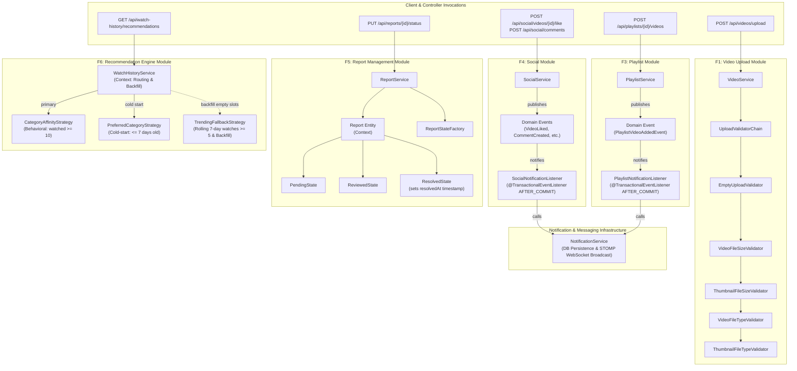

# StreamHub Design Patterns Reference & Viva Guide

This directory documents the Gang of Four (GoF) design patterns implemented and evaluated across the six core functions of the StreamHub video platform.

---

## 1. Design Patterns Summary Table

| Function | Member | Pattern | Integrated in Live Code? | Key Files | One-Line Benefit |
| :--- | :--- | :--- | :---: | :--- | :--- |
| **F1: Video Upload & Management** | Chandrasena H.L.L.S. `IT25103985` | **Chain of Responsibility** (Behavioral) | **Yes** | [`UploadValidator.java`](file:///d:/Study/SLIIT/Y2S1/SE_and_DDD%20project/Project/streamhub/backend/src/main/java/com/streamhub/video/validation/UploadValidator.java) [`UploadValidatorChain.java`](file:///d:/Study/SLIIT/Y2S1/SE_and_DDD%20project/Project/streamhub/backend/src/main/java/com/streamhub/video/validation/UploadValidatorChain.java) [`VideoService.java`](file:///d:/Study/SLIIT/Y2S1/SE_and_DDD%20project/Project/streamhub/backend/src/main/java/com/streamhub/video/service/VideoService.java) | Decouples sequential multipart upload validation checks into modular, fail-fast links without polluting core video processing logic. |
| **F2: Category Management** | Kawdawatta P.M.A.I.D. `IT25104019` | **Factory Method** (Creational) | **Standalone Example** *(Part B Gate: NO)* | [`CategoryFeed.java`](file:///d:/Study/SLIIT/Y2S1/SE_and_DDD%20project/Project/streamhub/docs/design-patterns/examples/f2-factory-method/example/factory/CategoryFeed.java) [`CategoryFeedCreator.java`](file:///d:/Study/SLIIT/Y2S1/SE_and_DDD%20project/Project/streamhub/docs/design-patterns/examples/f2-factory-method/example/factory/CategoryFeedCreator.java) [`FactoryMethodDemo.java`](file:///d:/Study/SLIIT/Y2S1/SE_and_DDD%20project/Project/streamhub/docs/design-patterns/examples/f2-factory-method/example/factory/FactoryMethodDemo.java) | Defers feed algorithm instantiation to creator subclasses, enabling OCP extensions for new feed varieties without modifying client code. |
| **F3: Playlist & Content Organization** | Nawarathna N.S.D. `IT25101962` | **Observer** (Behavioral) | **Yes** | [`PlaylistVideoAddedEvent.java`](file:///d:/Study/SLIIT/Y2S1/SE_and_DDD%20project/Project/streamhub/backend/src/main/java/com/streamhub/playlist/event/PlaylistVideoAddedEvent.java) [`PlaylistNotificationListener.java`](file:///d:/Study/SLIIT/Y2S1/SE_and_DDD%20project/Project/streamhub/backend/src/main/java/com/streamhub/playlist/event/PlaylistNotificationListener.java) [`PlaylistService.java`](file:///d:/Study/SLIIT/Y2S1/SE_and_DDD%20project/Project/streamhub/backend/src/main/java/com/streamhub/playlist/service/PlaylistService.java) | Decouples playlist mutations from recipient alerts by publishing transactional domain events asynchronously consumed by notification listeners. |
| **F4: Social Interaction (Likes & Comments)** | Rajapaksha R.M.H.N. `IT25101060` | **Observer** (Behavioral) | **Yes** | [`VideoLikedEvent.java`](file:///d:/Study/SLIIT/Y2S1/SE_and_DDD%20project/Project/streamhub/backend/src/main/java/com/streamhub/social/event/VideoLikedEvent.java) [`SocialNotificationListener.java`](file:///d:/Study/SLIIT/Y2S1/SE_and_DDD%20project/Project/streamhub/backend/src/main/java/com/streamhub/social/event/SocialNotificationListener.java) [`SocialService.java`](file:///d:/Study/SLIIT/Y2S1/SE_and_DDD%20project/Project/streamhub/backend/src/main/java/com/streamhub/social/service/SocialService.java) | Eliminates direct dependencies between social engagement workflows and notification/WebSocket delivery infrastructure. |
| **F5: Report & Moderation Management** | Weerasinghe W.M.V.K. `IT25102896` | **State** (Behavioral) | **Yes** | [`ReportState.java`](file:///d:/Study/SLIIT/Y2S1/SE_and_DDD%20project/Project/streamhub/backend/src/main/java/com/streamhub/report/state/ReportState.java) [`ReportStateFactory.java`](file:///d:/Study/SLIIT/Y2S1/SE_and_DDD%20project/Project/streamhub/backend/src/main/java/com/streamhub/report/state/ReportStateFactory.java) [`Report.java`](file:///d:/Study/SLIIT/Y2S1/SE_and_DDD%20project/Project/streamhub/backend/src/main/java/com/streamhub/report/entity/Report.java) [`ReportService.java`](file:///d:/Study/SLIIT/Y2S1/SE_and_DDD%20project/Project/streamhub/backend/src/main/java/com/streamhub/report/service/ReportService.java) | Encapsulates moderation lifecycle hooks and timestamp behaviors into state objects, eliminating scattered status if-statements. |
| **F6: Watch History & Recommendations** | Jayalath E.P.A.P. `IT25101967` | **Strategy** (Behavioral) | **Yes** | [`RecommendationStrategy.java`](file:///d:/Study/SLIIT/Y2S1/SE_and_DDD%20project/Project/streamhub/backend/src/main/java/com/streamhub/watchhistory/service/RecommendationStrategy.java) [`CategoryAffinityStrategy.java`](file:///d:/Study/SLIIT/Y2S1/SE_and_DDD%20project/Project/streamhub/backend/src/main/java/com/streamhub/watchhistory/service/CategoryAffinityStrategy.java) [`TrendingFallbackStrategy.java`](file:///d:/Study/SLIIT/Y2S1/SE_and_DDD%20project/Project/streamhub/backend/src/main/java/com/streamhub/watchhistory/service/TrendingFallbackStrategy.java) [`WatchHistoryService.java`](file:///d:/Study/SLIIT/Y2S1/SE_and_DDD%20project/Project/streamhub/backend/src/main/java/com/streamhub/watchhistory/service/WatchHistoryService.java) | Encapsulates distinct recommendation algorithms behind a common contract, enabling cold-start isolation and collaborative trending backfill. |

---

## 2. Design Patterns Applied (Final Report Section)

### F1: Chain of Responsibility in Video Upload Validation
- **Where Applied:** In [`backend/src/main/java/com/streamhub/video/validation/`](file:///d:/Study/SLIIT/Y2S1/SE_and_DDD%20project/Project/streamhub/backend/src/main/java/com/streamhub/video/validation/) invoked at the start of `VideoService.uploadVideo(...)`.
- **Why Applied:** Video upload accepts multipart binary files and thumbnails that require five distinct verification steps: empty file detection, video payload size cap ($\le 100\text{ MB}$), thumbnail size cap ($\le 2\text{ MB}$), video MIME type validation (`video/*`), and thumbnail image format validation (`image/jpeg`, `image/png`, `image/webp`). Hardcoding these checks inside `VideoService` created nested conditionals and violated Single Responsibility.
- **Architectural Benefit:** Validation steps are decomposed into independent, reusable links (`EmptyUploadValidator`, `VideoFileSizeValidator`, `ThumbnailFileSizeValidator`, `VideoFileTypeValidator`, `ThumbnailFileTypeValidator`) connected by `UploadValidatorChain`. Adding a new check (e.g., virus scanning or aspect-ratio verification) requires only creating a new link without modifying existing validators or the video upload transaction.

### F2: Factory Method for Category Video Feeds
- **Where Applied:** Evaluated for Category module; implemented as a standalone reference example in [`docs/design-patterns/examples/f2-factory-method/`](file:///d:/Study/SLIIT/Y2S1/SE_and_DDD%20project/Project/streamhub/docs/design-patterns/examples/f2-factory-method/example/factory/).
- **Why Standalone (Gate Decision):** An architectural audit of `CategoryService` revealed that existing conditional branching (`hasVideos`, `search != null`) only alters SQL query parameters passed to Spring Data JPA repositories. All branches return the identical entity type (`List<Category>`). Introducing a creational hierarchy into live production code would have been forced over-engineering.
- **Architectural Benefit:** The standalone model demonstrates the pattern's true intent: client code requests feeds via `CategoryFeedCreator.showFeed(...)`, while subclasses (`AllFeedCreator`, `SingleFeedCreator`) instantiate specialized products (`AllCategoryFeed`, `SingleCategoryFeed`). New feed algorithms can be introduced purely through subclassing, honoring the Open/Closed Principle.

### F3 & F4: Observer Pattern in Playlist & Social Notifications
- **Where Applied:** 
  - Playlist module: [`backend/src/main/java/com/streamhub/playlist/event/`](file:///d:/Study/SLIIT/Y2S1/SE_and_DDD%20project/Project/streamhub/backend/src/main/java/com/streamhub/playlist/event/)
  - Social module: [`backend/src/main/java/com/streamhub/social/event/`](file:///d:/Study/SLIIT/Y2S1/SE_and_DDD%20project/Project/streamhub/backend/src/main/java/com/streamhub/social/event/)
- **Why Applied:** Secondary side effects (such as notifying a video owner when their video is added to a public playlist, liked, commented on, or when a comment receives a reply) previously coupled `PlaylistService` and `SocialService` directly to `NotificationService`. A failure in WebSocket message formatting or notification persistence could threaten the primary transaction.
- **Architectural Benefit:** The services act as Subjects publishing immutable domain events (`PlaylistVideoAddedEvent`, `VideoLikedEvent`, `CommentLikedEvent`, `CommentCreatedEvent`, `CommentRepliedEvent`) via Spring’s `ApplicationEventPublisher`. The listeners (`PlaylistNotificationListener`, `SocialNotificationListener`) observe these events after database commit (`AFTER_COMMIT`), executing independently in a new transaction boundary (`REQUIRES_NEW`). Zero dependencies exist between the publishers and `NotificationService`.

### F5: State Pattern in Report Moderation Lifecycle
- **Where Applied:** In [`backend/src/main/java/com/streamhub/report/state/`](file:///d:/Study/SLIIT/Y2S1/SE_and_DDD%20project/Project/streamhub/backend/src/main/java/com/streamhub/report/state/) integrated into `Report` entity and `ReportService`.
- **Why Applied:** Content moderation reports progress through explicit lifecycle states (`PENDING`, `REVIEWED`, `RESOLVED`). As reports advance, specific side effects must execute (such as stamping `resolvedAt = LocalDateTime.now()` exclusively when entering `RESOLVED`).
- **Architectural Benefit:** Instead of procedural `if/else` checks scattered across service endpoints, status behaviors are encapsulated in dedicated state objects (`PendingState`, `ReviewedState`, `ResolvedState`, and fallback `GenericReportState`). The entity delegates state changes to `transitionTo(ReportState)`, keeping lifecycle logic cohesive and self-contained.

### F6: Strategy Pattern in Recommendation Engine
- **Where Applied:** In [`backend/src/main/java/com/streamhub/watchhistory/service/`](file:///d:/Study/SLIIT/Y2S1/SE_and_DDD%20project/Project/streamhub/backend/src/main/java/com/streamhub/watchhistory/service/) coordinated by `WatchHistoryService.getRecommendations(...)`.
- **Why Applied:** Recommendation generation varies drastically by user maturity: cold-start accounts rely on explicit onboarding interests, active users need behavioral affinity based on watch history, and platform fallbacks require 7-day rolling window engagement calculations. Hardcoding these diverse mathematical queries into a monolithic service violates SRP.
- **Architectural Benefit:** Algorithms are isolated behind `RecommendationStrategy`: `CategoryAffinityStrategy` (views $\ge 10$), `PreferredCategoryStrategy` (onboarding categories), and `TrendingFallbackStrategy` (rolling 7-day watch count $\ge 5$ and views $\ge 10$). `WatchHistoryService` acts as the context, routing to the primary strategy and utilizing trending as a de-duplicated backfill pipeline up to an effective limit of 4 items.

---

## 3. High-Level Architectural Diagram

---

## 4. Viva Cheat Sheet & Likely Examiner Questions

### F1: Chain of Responsibility (Video Upload Validation)
* **Q1: Why is this considered a "fail-fast" variant of the Chain of Responsibility?**
  * **Answer:** In traditional GoF Chain of Responsibility, any handler may consume a request and stop forwarding, or multiple handlers may process parts of it. In StreamHub's validation pipeline, handlers enforce preconditions: if any validation rule fails (e.g. video $> 100\text{ MB}$ or illegal MIME type), that handler immediately throws an `IllegalArgumentException`, halting the pipeline and aborting file writing before any storage I/O occurs.
* **Q2: How does a handler pass execution to the successor in code?**
  * **Answer:** Each handler inherits `checkNext(file, thumbnail)` from [`UploadValidator`](file:///d:/Study/SLIIT/Y2S1/SE_and_DDD%20project/Project/streamhub/backend/src/main/java/com/streamhub/video/validation/UploadValidator.java). If `this.next != null`, it calls `this.next.validate(file, thumbnail)`.
* **Q3: How would you add an antivirus scanner check?**
  * **Answer:** Create `VirusScanValidator extends UploadValidator`, implement `validate(...)`, and append it to the chain in [`UploadValidatorChain.java`](file:///d:/Study/SLIIT/Y2S1/SE_and_DDD%20project/Project/streamhub/backend/src/main/java/com/streamhub/video/validation/UploadValidatorChain.java). `VideoService` remains completely untouched.

---

### F2: Factory Method (Category Feed Creation)
* **Q1: Why was the Factory Method kept as a standalone example rather than integrated into production?**
  * **Answer:** In `CategoryService`, existing conditional checks only change SQL query parameters (`search`, `hasVideos`) inside Spring Data JPA repositories. All queries return the exact same entity type (`List<Category>`). Implementing Factory Method there would have created artificial class wrappers for SQL queries, violating KISS and YAGNI. It is implemented as a standalone reference model to show true polymorphic product creation.
* **Q2: In the standalone example, what is the Product and what is the Creator?**
  * **Answer:** The product interface is [`CategoryFeed`](file:///d:/Study/SLIIT/Y2S1/SE_and_DDD%20project/Project/streamhub/docs/design-patterns/examples/f2-factory-method/example/factory/CategoryFeed.java) (with concrete products [`AllCategoryFeed`](file:///d:/Study/SLIIT/Y2S1/SE_and_DDD%20project/Project/streamhub/docs/design-patterns/examples/f2-factory-method/example/factory/AllCategoryFeed.java) and [`SingleCategoryFeed`](file:///d:/Study/SLIIT/Y2S1/SE_and_DDD%20project/Project/streamhub/docs/design-patterns/examples/f2-factory-method/example/factory/SingleCategoryFeed.java)). The creator is the abstract class [`CategoryFeedCreator`](file:///d:/Study/SLIIT/Y2S1/SE_and_DDD%20project/Project/streamhub/docs/design-patterns/examples/f2-factory-method/example/factory/CategoryFeedCreator.java) with factory method `createFeed()`, overridden by [`AllFeedCreator`](file:///d:/Study/SLIIT/Y2S1/SE_and_DDD%20project/Project/streamhub/docs/design-patterns/examples/f2-factory-method/example/factory/AllFeedCreator.java) and [`SingleFeedCreator`](file:///d:/Study/SLIIT/Y2S1/SE_and_DDD%20project/Project/streamhub/docs/design-patterns/examples/f2-factory-method/example/factory/SingleFeedCreator.java).
* **Q3: How does the template method work in `CategoryFeedCreator`?**
  * **Answer:** `CategoryFeedCreator.showFeed(...)` calls `createFeed()` to obtain a `CategoryFeed` product and then executes `feed.load(all)`. The creator coordinates feed execution without coupling to concrete feed implementations.

---

### F3 & F4: Observer Pattern (Playlist & Social Notifications)
* **Q1: Why do `PlaylistNotificationListener` and `SocialNotificationListener` run with `AFTER_COMMIT` and `REQUIRES_NEW`?**
  * **Answer:** Notifications and WebSocket messages are secondary side effects. Running them after transaction commit (`@TransactionalEventListener(phase = TransactionPhase.AFTER_COMMIT)`) ensures notifications are never sent for actions that rollback. `Propagation.REQUIRES_NEW` guarantees the notification record is saved in its own independent database transaction, preventing notification failures from breaking core domain records.
* **Q2: What is the Subject and what is the Observer in F4?**
  * **Answer:** The subject is [`SocialService`](file:///d:/Study/SLIIT/Y2S1/SE_and_DDD%20project/Project/streamhub/backend/src/main/java/com/streamhub/social/service/SocialService.java), which publishes domain events (`VideoLikedEvent`, `CommentLikedEvent`, etc.) through Spring's `ApplicationEventPublisher`. The observer is [`SocialNotificationListener`](file:///d:/Study/SLIIT/Y2S1/SE_and_DDD%20project/Project/streamhub/backend/src/main/java/com/streamhub/social/event/SocialNotificationListener.java).
* **Q3: Why pass IDs and primitive values in domain events rather than attached JPA entities?**
  * **Answer:** Domain events (e.g. `PlaylistVideoAddedEvent`) are immutable records holding primitive/UUID values. Passing attached JPA entities across thread or transaction boundaries causes `LazyInitializationException` and memory leaks. Passing IDs ensures clean, detached boundary contracts.

---

### F5: State Pattern (Report Moderation Lifecycle)
* **Q1: How does the State pattern manage lifecycle timestamps like `resolvedAt`?**
  * **Answer:** In [`ResolvedState.java`](file:///d:/Study/SLIIT/Y2S1/SE_and_DDD%20project/Project/streamhub/backend/src/main/java/com/streamhub/report/state/ResolvedState.java), the `onEnter(Report report)` hook explicitly executes `report.setResolvedAt(LocalDateTime.now())` and `report.setStatus("RESOLVED")`. This eliminates the need for manual timestamp setters in controllers or service update methods.
* **Q2: What role does `ReportStateFactory` play?**
  * **Answer:** [`ReportStateFactory`](file:///d:/Study/SLIIT/Y2S1/SE_and_DDD%20project/Project/streamhub/backend/src/main/java/com/streamhub/report/state/ReportStateFactory.java) acts as the state resolver, converting raw database status strings (`PENDING`, `REVIEWED`, `RESOLVED`, or custom) into flyweight singleton state instances (`GenericReportState` for fallbacks).
* **Q3: What is the current status and planned extension for transition validation in F5?**
  * **Answer:** The `canTransitionTo(String targetStatus)` method is declared in [`ReportState`](file:///d:/Study/SLIIT/Y2S1/SE_and_DDD%20project/Project/streamhub/backend/src/main/java/com/streamhub/report/state/ReportState.java). Currently, states centralize lifecycle enter/exit hooks while allowing all status changes (`targetStatus != null`) to maintain 100% backward compatibility with administrative overrides. Guarding invalid illegal state jumps (e.g. preventing `RESOLVED -> PENDING` without admin privilege) is the planned extension.

---

### F6: Strategy Pattern (Recommendation Engine)
* **Q1: How does `WatchHistoryService` decide which strategy to execute?**
  * **Answer:** It inspects user profile data:
    1. New accounts ($\le 7\text{ days old}$) with $< 10$ watches: executes [`PreferredCategoryStrategy`](file:///d:/Study/SLIIT/Y2S1/SE_and_DDD%20project/Project/streamhub/backend/src/main/java/com/streamhub/watchhistory/service/PreferredCategoryStrategy.java) based on onboarding tags.
    2. Active accounts with $\ge 10$ watched videos: executes [`CategoryAffinityStrategy`](file:///d:/Study/SLIIT/Y2S1/SE_and_DDD%20project/Project/streamhub/backend/src/main/java/com/streamhub/watchhistory/service/CategoryAffinityStrategy.java) based on the user's top-watched category.
    3. If the primary strategy yields fewer than 4 items, [`TrendingFallbackStrategy`](file:///d:/Study/SLIIT/Y2S1/SE_and_DDD%20project/Project/streamhub/backend/src/main/java/com/streamhub/watchhistory/service/TrendingFallbackStrategy.java) backfills the empty slots with popular videos from the last 7 days.
* **Q2: Why is `TrendingFallbackStrategy` used as a backfill rather than purely an alternative branch?**
  * **Answer:** If a user’s preferred category or favorite genre contains only 1 or 2 eligible videos, returning an almost-empty feed harms engagement. The multi-strategy backfill combines the precision of personalized affinity with platform-wide popularity to guarantee a full recommendation row (up to `effectiveLimit = 4`).
* **Q3: How is algorithmic unit testing achieved for each strategy?**
  * **Answer:** As shown in [`WatchHistoryRecommendationTest.java`](file:///d:/Study/SLIIT/Y2S1/SE_and_DDD%20project/Project/streamhub/backend/src/test/java/com/streamhub/watchhistory/WatchHistoryRecommendationTest.java), each strategy is instantiated in isolation using Mockito. Repository mocks provide synthetic watch events or view counts, verifying that view thresholds (`MIN_VIEWS_FOR_TRENDING = 10`), recent watch counts (`MIN_RECENT_WATCHES_FOR_TRENDING = 5`), and own-video exclusions work properly without requiring an active database.

---

## 5. Directory Cross-Reference

Detailed individual pattern documentation is available in the dedicated markdown guides:
- [`F1: Chain of Responsibility`](file:///d:/Study/SLIIT/Y2S1/SE_and_DDD%20project/Project/streamhub/docs/design-patterns/F1_Chain_of_Responsibility.md)
- [`F2: Factory Method`](file:///d:/Study/SLIIT/Y2S1/SE_and_DDD%20project/Project/streamhub/docs/design-patterns/F2_Factory_Method.md)
- [`F3: Observer Pattern (Playlists)`](file:///d:/Study/SLIIT/Y2S1/SE_and_DDD%20project/Project/streamhub/docs/design-patterns/F3_Observer_Pattern.md)
- [`F4: Observer Pattern (Social Interactions)`](file:///d:/Study/SLIIT/Y2S1/SE_and_DDD%20project/Project/streamhub/docs/design-patterns/F4_Observer_Pattern.md)
- [`F5: State Pattern`](file:///d:/Study/SLIIT/Y2S1/SE_and_DDD%20project/Project/streamhub/docs/design-patterns/F5_State_Pattern.md)
- [`F6: Strategy Pattern`](file:///d:/Study/SLIIT/Y2S1/SE_and_DDD%20project/Project/streamhub/docs/design-patterns/F6_Strategy_Pattern.md)
